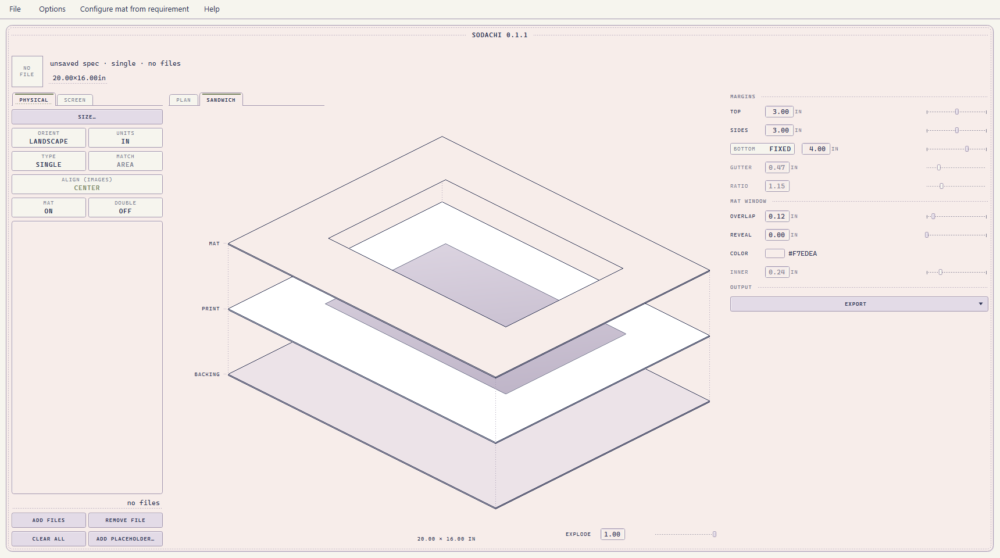

# Sodachi

Sodachi lays out images for framing and for posting. It designs mat boards
for physical prints, and adds exact pixel borders to images for screens. It
works with film scans, digital work, or any flat artwork.



## Install

**Windows:** download the zip from
[Releases](https://github.com/Stillll-ph/Sodachi/releases), unzip it
anywhere, and run `sodachi-gui.exe`. Nothing is installed. The executable is
unsigned, so Windows may warn you the first time it runs.

**From source:** requires Python 3.11 or later.

```bash
pip install "pyvips[binary]"
pip install -e ".[gui]"
sodachi-gui
```

To build the Windows executable yourself, run `packaging/build_exe.py`.

## The Physical tab: mat boards

Set the paper size and margins, add your images, and Sodachi works out the
layout. For a frame you haven't made yet, add a placeholder with its
proportions instead.

A layout can hold one image or several — a diptych, triptych or grid. When
there are several, each gets the same printed area by default, so a portrait
beside a landscape reads as an equal. The mat can show a strip of paper
inside the window (a reveal), or use a second board for a double mat. The
Sandwich view shows the boards and print as separate layers.

To start from the result instead — a print size you want, or a frame you
already own — use **Configure mat from requirement** in the menu bar.

Every export comes from the same solved layout, so the preview and the files
always agree:

- **Mat guide.** A PDF to print and cut from by hand. It prints at exactly
  100% and is mirrored, because mats are cut from the back. Turn off any
  print scaling; a 100 mm bar on the page lets you check the size. Corner
  marks show how far to overcut for your board's thickness.
- **Cutter file.** DXF, SVG or CSV for a computerised mat cutter. It is not
  mirrored: the machine handles orientation, and a mirrored file would cut a
  mirrored mat. A double mat's top board is on its own layer.
- **Check table.** Every measurement in millimetres or inches, ready to copy
  into your own print software, including the smallest print each window can
  hold.

Sodachi doesn't print your artwork. If you print your own work you likely
have software for that already; the check table gives it the numbers.

## The Screen tab: borders for posting

Add images, set a border in pixels, and export. By default each image gets
its own canvas, sized to fit the image plus its borders, so a 300 px border
comes out at exactly 300 px and the image is never resized. To post into a
fixed size instead, switch **Canvas** to **Fixed** and the image is scaled
to fit.

A border can be one value for all sides, or set separately for the top,
sides and bottom. Files are written as PNG, JPG at maximum quality, or TIFF,
in 8-bit sRGB. Turn on **Batch** to export every queued image at once into a
folder you choose. Border settings you use often can be saved under
**Layouts**.

## Other features

- Designs save as plain YAML spec files. A spec keeps the frames the layout
  was built around, so a mat design reopens complete without the images.
- **Options → Beginner controls** adds a one-line explanation beside every
  control.
- Fifteen colour palettes, under **Options → Palette**.

## Tried and dropped

Kept here so they aren't reinvented:

- **Rendering the print on the Physical tab.** Print workflows need the
  numbers, not another image file.
- **Batch export and file pairing for mats.** A mat is designed once and cut
  many times. The order of the file list is the pairing.
- **Restoring the last design on launch.** A design belongs in its spec file,
  and the app opens the same way every time.
- **Sizing the screen canvas from the paper.** The image had to be resized to
  fill it and the spare space landed unevenly, so a 300 px border never came
  out at 300 px.
- **Capping screen exports at 4096 px.** It shrank canvases that had been set
  in exact pixels.
- **Choosing export folders automatically.** You choose where files go.
- **The same command in several places.** Each action lives in one place.
- **Requirements for several frames at once, and quietly fixing impossible
  settings.** The normal layout already covers the first; for the second, a
  clear refusal beats a silent change.

## Tests

Sodachi is developed against more than 1,100 tests, run in full before every
packaged build. They check the layout geometry, read exported files back from
disk, and parse cutter files against the layout. The tests are not included in
this repository.

## License

You may run Sodachi, unmodified, for any purpose, personal or commercial. The
source is published for reference only; all other rights are reserved. See
[LICENSE](LICENSE).
